<p align="center">
  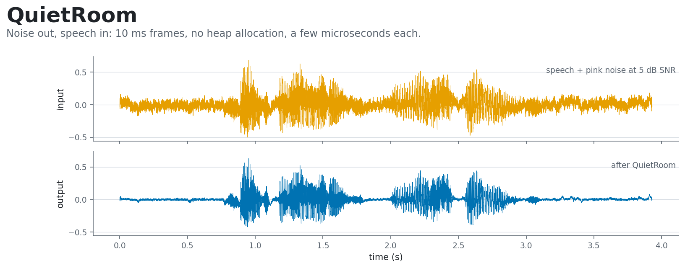
</p>

<p align="center">
  <a href="https://github.com/abhinavannareddy/quietroom/actions/workflows/ci.yml"></a>
  <a href="LICENSE"></a>
  <a href="https://en.cppreference.com/w/cpp/17"></a>
</p>

Real-time audio has one hard rule: if processing a buffer takes longer than the buffer lasts, the
next one arrives before you are done and the sound breaks up. QuietRoom is a small C++17 library
and command-line tool that removes steady background noise from 16 kHz speech in 10 ms frames, and
checks, with numbers, that it stays far inside that deadline. A voice activity detector finds the
moments when nobody is talking, the noise spectrum is learned from those moments, and spectral
subtraction takes it out. Nothing is allocated while a frame is processed.

It is deliberately not a neural network. The whole thing is classic signal processing you can read
in an afternoon, and the interesting part is being honest about where it works and where it does not.

## At a glance

Measured on one laptop (AMD Ryzen 7 7730U, Windows 11, clang 21.1.0 `-O3`); details and caveats below.

| | |
|---|---|
| **Time per frame** | about 10 µs typical, p99 21 to 44 µs, against a 10,000 µs deadline |
| **Frames over the 10 ms deadline** | 0 of 427,493 |
| **Noise removed, 5 dB input** | white 7.4 dB, pink 6.1 dB, 50 Hz hum 8.4 dB, **babble only 2.8 dB** |
| **Voice activity detection** | 82.5% accurate at 5 dB input, 11.8% of speech frames missed |
| **Allocations in `process_frame()`** | 0, enforced by a test |
| **Tests** | 39, also run under ASan and UBSan |

## See it work

Pink noise at 5 dB SNR over a LibriSpeech sentence, before and after. The noise floor drops and the
words are left alone:

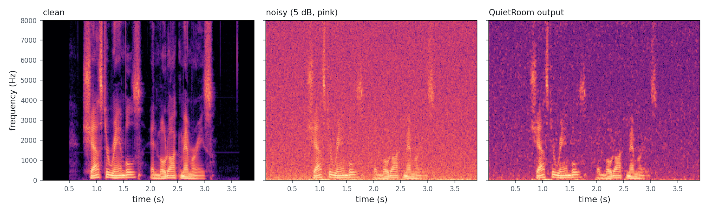

You can listen too. These are the same clips as the pictures, the output made by `quietroom_cli`:

| | noisy | cleaned |
|---|---|---|
| pink noise, 5 dB | [pink_5db_noisy.wav](docs/demo/pink_5db_noisy.wav) | [pink_5db_cleaned.wav](docs/demo/pink_5db_cleaned.wav) |
| babble, 5 dB (the hard case) | [babble_5db_noisy.wav](docs/demo/babble_5db_noisy.wav) | [babble_5db_cleaned.wav](docs/demo/babble_5db_cleaned.wav) |

I measured these but I have not run listening tests, so judge the sound for yourself. Expect a faint
warbling in the quiet gaps: that is musical noise, explained below.

## Try it

You need CMake 3.16 or newer and a C++17 compiler. CMake downloads Google Test and Google Benchmark
the first time you configure (pinned by hash), so that first configure needs network access.

**Linux and macOS**

```bash
git clone https://github.com/abhinavannareddy/quietroom.git
cd quietroom
cmake -S . -B build -DCMAKE_BUILD_TYPE=Release
cmake --build build --parallel
ctest --test-dir build --output-on-failure
./build/quietroom_cli data/regression/noisy_white_5db.wav cleaned.wav
```

**Windows** (PowerShell, from a Visual Studio Developer prompt)

```powershell
git clone https://github.com/abhinavannareddy/quietroom.git
cd quietroom
cmake -S . -B build
cmake --build build --config Release --parallel
ctest --test-dir build -C Release --output-on-failure
.\build\Release\quietroom_cli.exe data\regression\noisy_white_5db.wav cleaned.wav
```

With Ninja (`-G Ninja`) the executable is `build\quietroom_cli.exe` instead.

The CLI reports timing and what the VAD decided:

```text
frames: 393 (3.93 s)
compute per frame: mean 10.5 us, p50 10.4 us, p99 11.2 us, max 40.6 us
deadline misses: 0 over 10 ms, 0 over 2 ms; real-time factor 0.00105
VAD: 161 speech frames, 232 non-speech frames
```

Options (`quietroom_cli --help`): `--over-subtraction`, `--floor`, `--smoothing`, `--hangover`,
`--bypass`, `--vad-csv FILE`, `--json FILE`. Input must be 16 kHz mono, 16-bit PCM or 32-bit float
WAV, up to 256 MiB.

**As a library**

```cpp
#include "quietroom/pipeline.hpp"

quietroom::Config config;          // tuned defaults; every parameter is documented in config.hpp
quietroom::Pipeline pipeline(config);

// once per 10 ms hop (160 samples of quietroom::Sample, float by default):
pipeline.process_frame(in, out);   // out is the input delayed by one hop
```

Link the `quietroom` CMake target; `-DQUIETROOM_DOUBLE=ON` switches to double. Out-of-range `Config`
values are clamped, and NaN or infinite input samples are treated as silence.

Verified on Windows (clang 21 via Zig and Ninja) and Linux (GCC 13.3: Release, Debug, ASan+UBSan,
double precision, in a clean checkout). The MSVC and MinGW builds and macOS have not been run by me;
CI covers macOS once it has run on GitHub.

## How it works

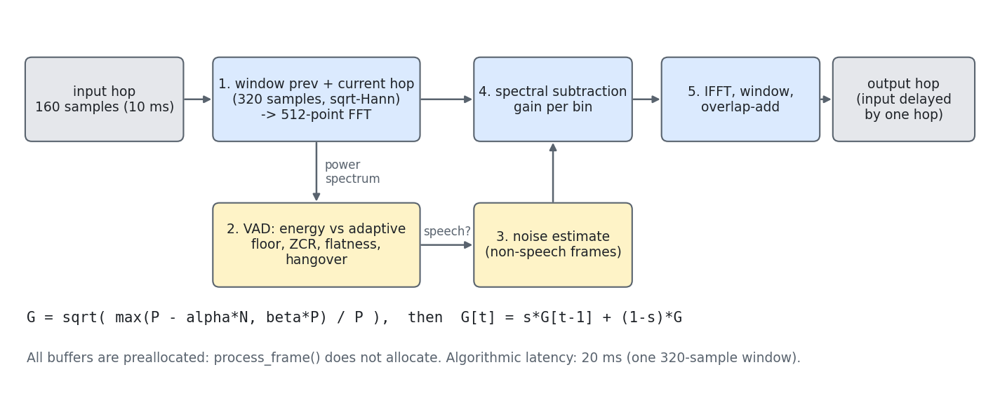

Each call takes one hop of 160 samples (10 ms at 16 kHz) and runs five steps. Defaults live in
`include/quietroom/config.hpp`.

### 1. Window and transform

The previous hop and the current hop are joined into 320 samples, multiplied by a square-root Hann
window and zero-padded to 512 points for the FFT.

```text
w[n] = sqrt( 0.5 * (1 - cos(2*pi*n / 320)) ),   n = 0..319
```

The same window is applied again after processing. Because `w[n]^2 + w[n+160]^2 = 1`, a signal that
passes through untouched comes back exactly (a test checks it to within 1e-5). The FFT is a
hand-written radix-2 transform with its twiddles built once: a 62-line source file with no
dependency that cannot allocate.

### 2. Is anyone talking?

Three features of the newest hop and the 20 ms spectrum:

```text
E = 10*log10( mean(x^2) + 1e-10 )                              frame energy, dB
Z = sign changes / 159                                         zero-crossing rate
F = geometric mean(P[4..127]) / arithmetic mean(P[4..127])     spectral flatness
```

`E` is compared with a floor `f` that falls fast and rises slowly: if `E < f` then
`f += 0.2 * (E - f)`, otherwise `f += 0.02 dB` per frame. A frame is speech if `E > f + 12 dB`, or if
`E > f + 6 dB` and it does not look like noise, meaning `F > 0.5` and `Z > 0.3` (flat in frequency
and busy in time). Without that last test, loud hiss would count as speech. If the answer has been
"speech" for 3 seconds without a break the floor is almost certainly too low (a stream that began
with exact zeros does this), so it climbs at 0.5 dB per frame until things settle.

After the last speech frame the detector keeps saying "speech" for 8 more frames (80 ms), the
**hangover**, so word endings are not clipped and the noise estimate does not learn from them.

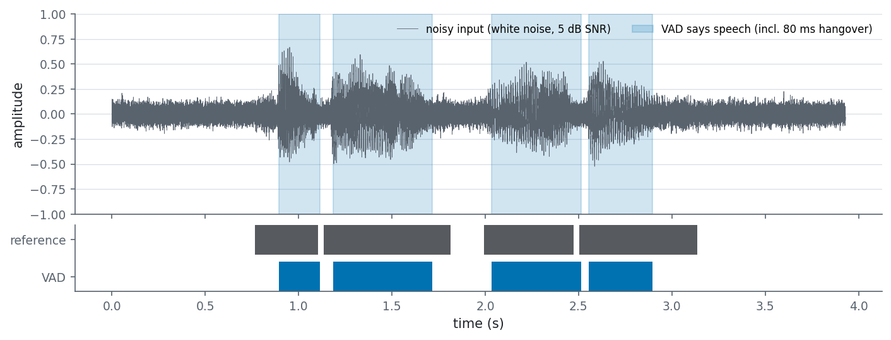

The detector (blue) follows the speech (dark bars) but not perfectly. In this clip it starts a little
late, because it waits for the energy to clear the floor, and it stops earlier than the reference
label in several places, because the labels include the quiet tails of words. Those missed tails are
where the false-silence numbers below come from; the hangover keeps the detector from ending even sooner.

### 3. Learn the noise

The first 20 frames (200 ms) are assumed to be noise and averaged. After that the estimate `N` is
updated only on frames the detector calls non-speech, and frozen during speech:

```text
N = 0.95 * N + 0.05 * P
```

### 4. Subtract it

For each of the 257 frequency bins, with `P` the power of the noisy frame and `N` the noise estimate:

```text
S      = max( P - alpha*N,  beta*P )        alpha = 3.0 (over-subtraction), beta = 0.02 (floor)
G_raw  = sqrt( S / P )                       amplitude gain, between sqrt(beta) and 1
G[t]   = s*G[t-1] + (1 - s)*G_raw            s = 0.3 (smoothing across time)
```

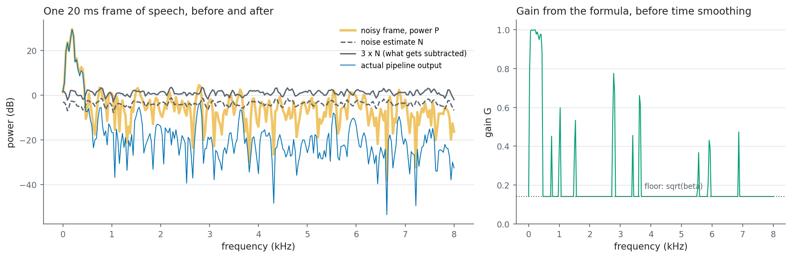

In this frame of speech (left), the harmonics below 500 Hz stand far above `3 x N`, so the gain stays
near 1 there (right) and the output (blue) matches the input. Everywhere else the frame is mostly
noise, the subtraction takes it to the floor, and the output drops by about 17 dB (median over the
bins above 1 kHz; most bins fall between 9 and 17 dB).

Subtracting more than the average noise (`alpha > 1`) removes more, because the noise power in any one
frame fluctuates around its mean, and it also bites into the speech. The floor stops bins from going
to zero, which is what creates the isolated tones called musical noise. Smoothing the gain over time
softens that, at the price of reacting more slowly. The gain is applied to the complex spectrum and
mirrored onto the negative-frequency bins so the result stays real.

### 5. Back to audio

The inverse FFT, the second window, and the sum with the tail of the previous frame produce one
finished hop.

### Choosing alpha

The defaults came from a parameter sweep on three clips, scored on three clips the sweep never saw.
This plot varies only `alpha` and holds the rest fixed (24 runs per point):

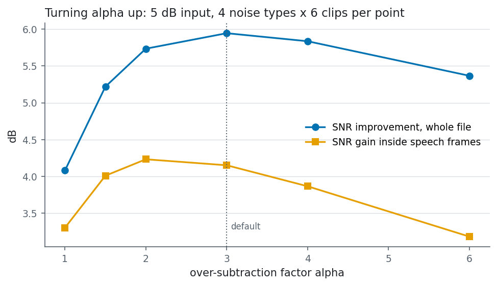

Both curves rise, peak near the default, then fall: past `alpha` of about 3 the extra subtraction
removes speech faster than noise. The curve is flat near the top, so the exact value matters less than
staying out of the extremes.

## The latency budget

Two numbers get confused, so here they are side by side.

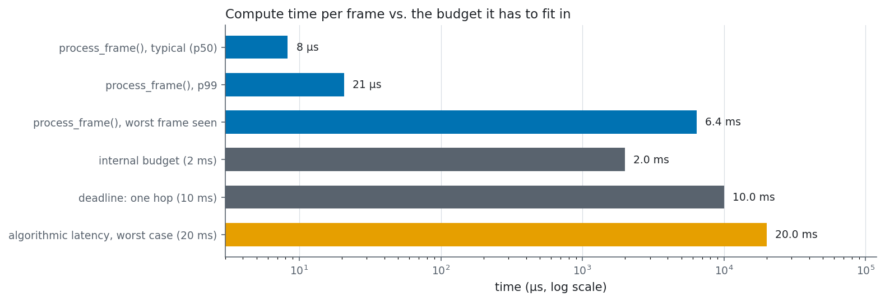

**Compute time per frame** is how long `process_frame()` runs: about 10 µs typical, against the 10,000 µs
a hop allows. The gap is roughly a thousand times, which is why a laptop's occasional scheduling
hiccup shows up as a rare outlier and not as a trend.

**Algorithmic latency** is how long a sample waits before it comes out, and it does not depend on how
fast the code is. Overlap-add needs the next window to finish a hop, so the output is the input
delayed by exactly one hop (10 ms). From the moment a sample arrives to the moment it can be played is
10 to 20 ms; the worst case is the full 20 ms analysis window. That is fixed by the design. I tested
the one-hop delay but did not benchmark it. The CLI removes the delay so the output lines up with the input.

## Results in full

Everything here is from the committed runs in [`docs/results/`](docs/results/); the method is in
[`docs/EVALUATION.md`](docs/EVALUATION.md). Build: float samples, clang 21.1.0 (through Zig 0.16), `-O3 -DNDEBUG`.

**Time per frame** (`process_frame()` on one hop, monotonic clock)

| | CLI, 72 evaluation runs (37,908 frames) | Google Benchmark, 5 repetitions (389,585 frames) |
|---|---|---|
| mean | 13.1 µs | 10.1 µs (median of repetitions) |
| p50 | 9.5 µs | 8.3 µs |
| p99 | 44.0 µs | 20.7 µs |
| max | 2,188 µs | 6,412 µs (worst repetition) |
| frames over 10 ms | 0 | 0 |
| frames over 2 ms | 1 | 16 |
| real-time factor | 0.0013 | about 0.001 |

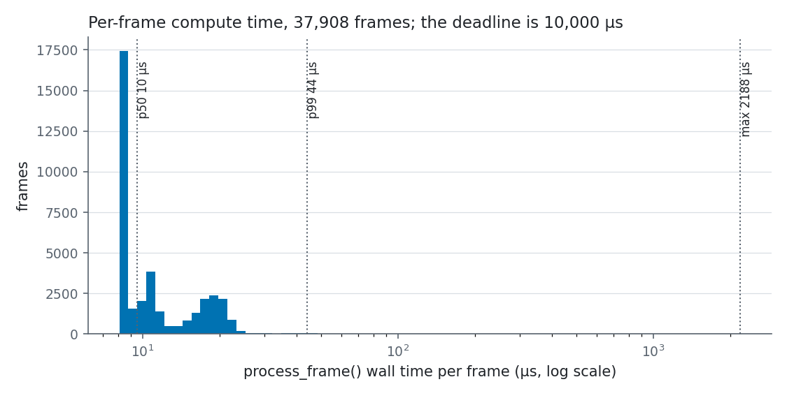

**SNR improvement** (dB, mean over 6 LibriSpeech clips; output SNR minus input SNR)

| noise | 0 dB in | 5 dB in | 10 dB in |
|---|---|---|---|
| white | 7.15 | 7.39 | 7.67 |
| pink | 6.40 | 6.11 | 5.84 |
| 50 Hz hum | 8.21 | 8.42 | 7.51 |
| babble | 3.22 | 2.83 | 2.72 |

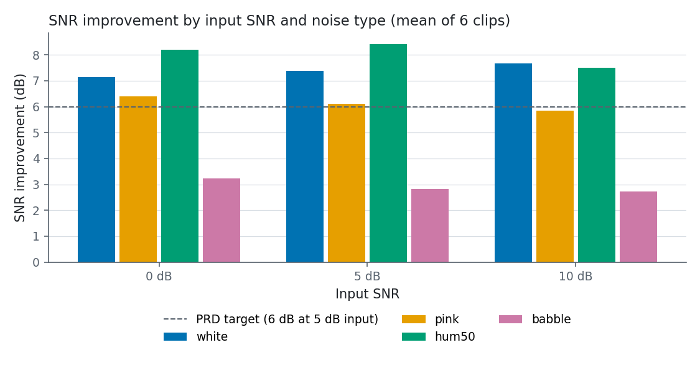

**Voice activity detection** against labels derived from the clean clips (see Limitations)

| input SNR | accuracy | false-silence rate | false-speech rate |
|---|---|---|---|
| 0 dB | 66.8% | 33.6% | 32.6% |
| 5 dB | 82.5% | 11.8% | 25.5% |
| 10 dB | 86.0% | 5.9% | 25.3% |
| all runs | 78.4% | 17.1% | 27.8% |

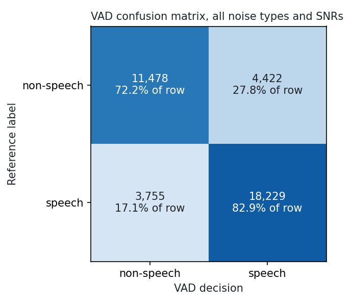

**Against the PRD targets**

| target | result |
|---|---|
| mean under 1 ms per frame | met: about 0.01 ms |
| p99 under 2 ms | met: 21 to 80 µs across the repetitions and runs |
| no frame over 10 ms | met: 0 of 427,493 timed frames |
| frames over 2 ms: report, target 0 | **missed**: 17 of 427,493 (0.004%), the worst at 6.4 ms |
| real-time factor under 0.1 | met: about 0.001 |
| at least 6 dB SNR improvement at 5 dB input | met for white (7.39), pink (6.11) and hum (8.42); **missed for babble (2.83)** |
| VAD accuracy with a confusion matrix | reported above |
| zero allocations in `process_frame()` | met, enforced by a test |

The 2 ms misses are single frames that took far longer than the thousands around them, which points
at the operating system pre-empting the thread on a laptop that was also running other work. I did not
trace them further. Timings change from run to run (the CLI runs recorded maxima between 0.2 and
2.2 ms), so read the maximum as a property of the machine at that moment, not of the algorithm.

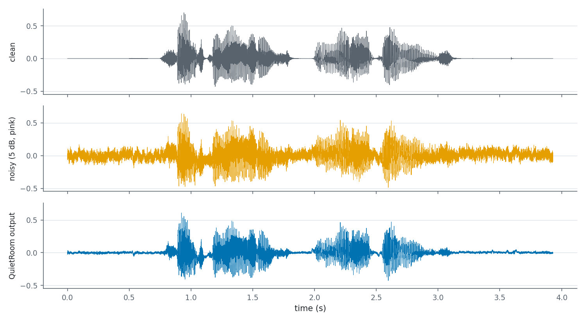

## Reproduce every result

```bash
python -m pip install -r python/requirements.txt
scripts/reproduce.sh            # Linux, macOS, Git Bash
```

On Windows, `scripts\reproduce.ps1` does the same from PowerShell; I have not run it myself because my
shell was not allowed to run PowerShell scripts, so treat it as untested. The Bash script rebuilds in
Release, runs the tests, runs the benchmark into `docs/results/bench.json`, then runs
`python/evaluate.py` (mixes the clips with noise, calls the CLI, rewrites `docs/results/` and the
evaluation plots) and `python/make_figures.py` (the illustrative figures and demo audio). Your timings
will differ from mine.

## How it is tested

39 tests, run by `ctest`:

- framing, FFT, VAD, noise estimator, spectral subtraction, the pipeline and WAV parsing, plus a
  regression test that runs the real CLI on a fixed noisy clip and checks both the SNR improvement and
  the exit code for a missing file;
- `test_no_alloc` replaces `operator new` and checks that 3 seconds of audio through `process_frame()`
  allocates nothing (its own executable, because the replacement is global);
- hostile input: NaN and infinite samples, lying chunk sizes, wrong sample rate, unsupported WAV formats.

CI (`.github/workflows/ci.yml`) builds Linux and macOS in Release and Debug, runs an ASan+UBSan job where
UBSan aborts on a finding, builds the double-precision option, and checks formatting and clang-tidy. It
uploads the benchmark JSON as an artifact and never fails on timing.

## What went wrong along the way

The first defaults gave 5.9 dB on white noise, 4.7 on pink and 2.5 on babble at 5 dB input, just under
the target. A sweep over the three subtraction parameters, tuned on three clips and scored on three
others, raised the held-out average over the four noise types from 4.6 to 5.4 dB at the time, and became
the defaults. The cost is that a lower floor and lighter smoothing favour noise removal over listening
comfort.

Linux caught two mistakes in my allocation test that Windows did not. GCC deleted the "does my counter
work" check, because a `new`/`delete` pair with an unused result may be removed; and under AddressSanitizer
I had replaced only some `operator new` variants, so memory from the library's `nothrow` variant was freed
by my `free()`. The test now replaces the whole family and keeps the allocation observable.

A round-trip test found that my WAV writer scaled by 32767 while the reader divided by 32768, which shifts
values near full scale by more than one quantisation step. A review pass found that one NaN sample would
have poisoned every later frame (the smoothing filters are recursive and `0.3 * NaN` is NaN), that the VAD
floor would need an estimated 20 s to catch up after a stream that began with silence, and that the UBSan
half of the sanitizer job printed errors without failing. All three are fixed and have tests.

## Limitations

**Musical noise.** Spectral subtraction leaves short isolated tones where the noise estimate was wrong
for a moment. The floor and the gain smoothing reduce it, but the defaults were chosen by SNR, which does
not measure it, and I have not done listening tests. The output spectrogram shows the residue.

**Non-stationary noise.** The noise estimate is a slow average, so it cannot follow noise that changes
quickly. Babble is the clear case: 2.8 dB at 5 dB input against 6 to 8 dB for the steady noises. Horns
and keyboard clatter are a stated non-goal.

**VAD errors.** The detector calls 25 to 33% of non-speech frames speech, partly by design (the 80 ms
hangover extends every utterance) and partly because the reference labels are strict. At 0 dB input it
misses a third of the speech frames (33.6%). A false "speech" freezes the noise estimate; a false
"silence" lets speech leak into it and be subtracted.

**Labels and data.** LibriSpeech has no speech/non-speech annotation, so the reference labels are frames
within 35 dB of the clean clip's loudest frame. Six clips from three speakers is a small test set, and
the babble comes from one speaker's other recordings. The DEMAND noise set and STOI/PESQ are not used.

**Start-up.** The first 200 ms must be noise; a stream that starts with speech will have it learned as noise.

**Scope.** Mono 16 kHz WAV only, and no microphone capture.

## What I would do next

Track the noise floor continuously (minimum statistics) so it follows babble and other changing noise;
replace the subtraction rule with a decision-directed Wiener filter or a log-spectral estimator to cut
musical noise; tune the VAD on annotated speech; add STOI/PESQ and a small listening test; try a
real-input FFT and SIMD and then measure on an ARM board, where the latency budget is tight; and run the
MSVC, MinGW and macOS builds and publish their timings next to this laptop's.

## Layout

```text
include/quietroom/   public headers (pipeline, config, wav, ...)
src/                 fft, framing, vad, noise_estimator, spectral_sub, pipeline, wav
cli/                 quietroom_cli
bench/               Google Benchmark targets
tests/               unit tests, allocation test, CLI regression test
python/              evaluate.py, make_figures.py, tune.py, make_test_clips.py, plots
data/                small LibriSpeech-derived clips; see data/LICENSES.md
docs/                DESIGN.md, EVALUATION.md, DECISIONS.md, results/, images/, demo/
scripts/             reproduce.sh, reproduce.ps1
```

## License

MIT, see [LICENSE](LICENSE). The speech clips in `data/` and the demo audio are derived from LibriSpeech
(CC BY 4.0); see [data/LICENSES.md](data/LICENSES.md). Contributing: [CONTRIBUTING.md](CONTRIBUTING.md).
History: [CHANGELOG.md](CHANGELOG.md).
